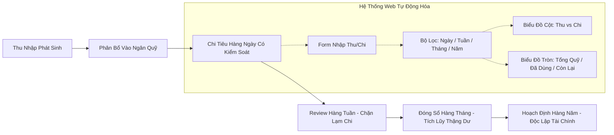
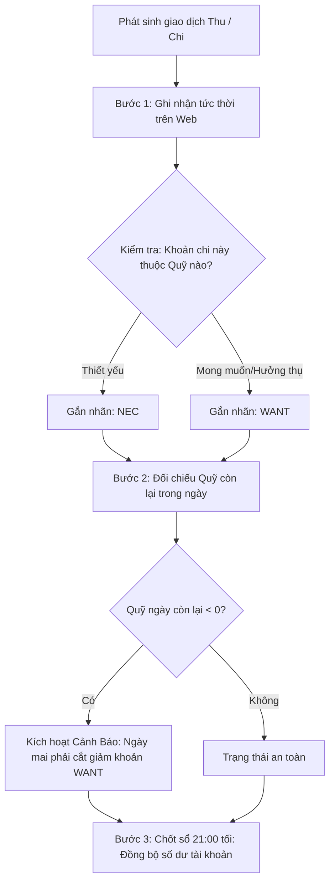
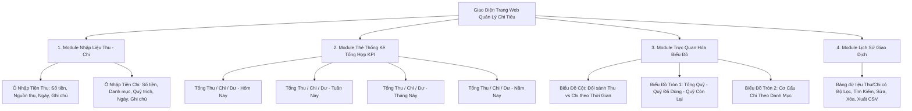
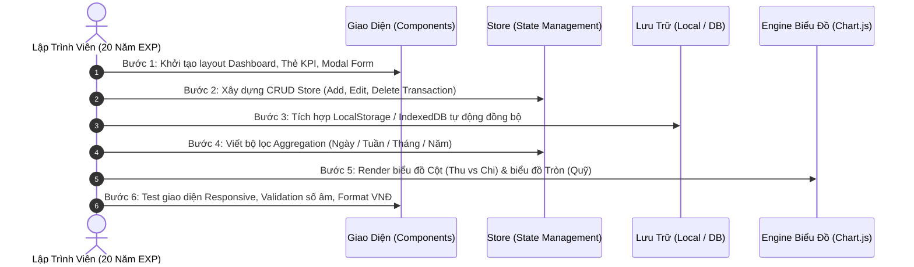

# QUY TRÌNH QUẢN LÝ CHI TIÊU VÀ PHÁT TRIỂN HỆ THỐNG WEB TÀI CHÍNH CÁ NHÂN
> **Tác giả:** Chuyên gia Cố vấn Tài chính Cá nhân & Kiến trúc sư Giải pháp Web (20+ năm kinh nghiệm)  
> **Tài liệu:** Hướng dẫn chuẩn hóa quy trình vận hành tài chính cá nhân và tài liệu thiết kế - thi công ứng dụng Web Quản Lý Thu Chi Toàn Diện.  
> **Phiên bản:** 1.0.0 | **Tập tin:** `QUITRINH.MD`

---

## MỤC LỤC
1. [TỔNG QUAN VÀ TRIẾT LÝ QUẢN TRỊ DÒNG TIỀN](#1-tổng-quan-và-triết-lý-quản-trị-dòng-tiền)
2. [PHẦN I: QUY TRÌNH QUẢN LÝ CHI TIÊU CHUẨN HÓA (VẬN HÀNH THỰC TẾ)](#phần-i-quy-trình-quản-lý-chi-tiêu-chuẩn-hóa)
   - [1. Quy tắc phân bổ quỹ: JARS kết hợp 50/30/20 cải tiến](#1-quy-tắc-phân-bổ-quỹ-jars-kết-hợp-503020-cải-tiến)
   - [2. Quy trình kiểm soát Dòng tiền Hàng Ngày (Daily Workflow)](#2-quy-trình-kiểm-soát-dòng-tiền-hàng-ngày-daily-workflow)
   - [3. Quy trình đối soát & cân đối Hàng Tuần (Weekly Review)](#3-quy-trình-đối-soát--cân-đối-hàng-tuần-weekly-review)
   - [4. Quy trình đóng sổ & phân tích Hàng Tháng (Monthly Closing)](#4-quy-trình-đóng-sổ--phân-tích-hàng-tháng-monthly-closing)
   - [5. Quy trình tổng kết & hoạch định Hàng Năm (Annual Planning)](#5-quy-trình-tổng-kết--hoạch-định-hàng-năm-annual-planning)
   - [6. Hệ thống chỉ số đo lường & cảnh báo rủi ro (Financial KPIs)](#6-hệ-thống-chỉ-số-đo-lường--cảnh-báo-rủi-ro-financial-kpis)
3. [PHẦN II: QUY TRÌNH THIẾT KẾ & XÂY DỰNG TRANG WEB QUẢN LÝ CHI TIÊU](#phần-ii-quy-trình-thiết-kế--xây-dựng-trang-web-quản-lý-chi-tiêu)
   - [1. Phân tích yêu cầu chức năng cốt lõi (Functional Requirements)](#1-phân-tích-yêu-cầu-chức-năng-cốt-lõi-functional-requirements)
   - [2. Kiến trúc giải pháp kỹ thuật & Công nghệ (Tech Stack)](#2-kiến-trúc-giải-pháp-kỹ-thuật--công-nghệ-tech-stack)
   - [3. Thiết kế mô hình dữ liệu (Database Schema / Data Models)](#3-thiết-kế-mô-hình-dữ-liệu-database-schema--data-models)
   - [4. Thuật toán tổng hợp & Lọc dữ liệu Thời gian thực (Daily/Weekly/Monthly/Yearly)](#4-thuật-toán-tổng-hợp--lọc-dữ-liệu-thời-gian-thực)
   - [5. Đặc tả kiến trúc trực quan hóa biểu đồ (Data Visualization Architecture)](#5-đặc-tả-kiến-trúc-trực-quan-hóa-biểu-đồ)
   - [6. Lộ trình 6 bước triển khai lập trình từ 0 đến Web hoàn chỉnh (Step-by-step Implementation)](#6-lộ-trình-6-bước-triển-khai-lập-trình)
   - [7. Tiêu chuẩn UI/UX và Bảo mật Dữ liệu Tài chính](#7-tiêu-chuẩn-uiux-và-bảo-mật-dữ-liệu-tài-chính)
4. [TỔNG KẾT & DANH MỤC KIỂM TRA (CHECKLIST TRIỂN KHAI)](#tổng-kết--danh-mục-kiểm-tra-checklist-triển-khai)

---

## 1. TỔNG QUAN VÀ TRIẾT LÝ QUẢN TRỊ DÒNG TIỀN

Trong 20 năm xây dựng các hệ thống tài chính - ngân hàng và tư vấn quản trị tài chính cá nhân, nguyên lý sống còn là:
> **"Bạn không thể quản lý những gì bạn không đo lường."**  
> Dòng tiền cá nhân giống hệt dòng tiền doanh nghiệp: **Lợi nhuận ròng = Tổng Thu nhập - Tổng Chi phí**. Chi tiêu không có kế hoạch là nguyên nhân số 1 dẫn đến khủng hoảng tài chính, bất kể mức thu nhập của bạn là 10 triệu hay 100 triệu mỗi tháng.

Quy trình này chia làm 2 trụ cột song hành:
1. **Trụ cột Phương pháp luận:** Kỷ luật quản trị dòng tiền từ Ngày $\rightarrow$ Tuần $\rightarrow$ Tháng $\rightarrow$ Năm.
2. **Trụ cột Kỹ thuật số (Web App):** Tự động hóa việc ghi chép, tính toán tổng hợp, trực quan hóa trạng thái ngân quỹ bằng đồ thị tương tác.



---

# PHẦN I: QUY TRÌNH QUẢN LÝ CHI TIÊU CHUẨN HÓA

---

### 1. Quy tắc phân bổ 3 Quỹ: Chi Tiêu - Tiết Kiệm - Khẩn Cấp
Để tránh cạn kiệt ngân quỹ hoặc rơi vào tình trạng "không biết tiền đi đâu", hệ thống thiết lập **3 Ngân Quỹ Độc Lập**:

| Tên Quỹ | Mục đích sử dụng | Nguồn chuyển tiền vào | Nguyên tắc kiểm soát |
| :--- | :--- | :--- | :--- |
| **🛒 Quỹ Chi Tiêu (Spending)** | Chi trả ăn uống, nhà cửa, xăng xe, hóa đơn sinh hoạt | Nạp trực tiếp hoặc trích từ Thu nhập | **CẤM ĐỂ QUỸ ÂM**: Mọi khoản chi tiêu sinh hoạt đều trừ vào đây |
| **🏦 Quỹ Tiết Kiệm (Savings)** | Tích lũy mua sắm lớn, du lịch, học tập, đầu tư tương lai | 1. Từ Thu Nhập<br>2. Trích từ Quỹ Chi Tiêu | Bảo toàn vốn, tích lũy có mục tiêu |
| **🚨 Quỹ Khẩn Cấp (Emergency)** | Dự phòng biến cố, bệnh tật, y tế, thất nghiệp 3-6 tháng | 1. Từ Thu Nhập<br>2. Trích từ Quỹ Chi Tiêu | Bất khả xâm phạm, chỉ dùng khi có sự cố khẩn cấp |

**Quy tắc vận hành 2 Nguồn nạp tiền:**
1. **Nguồn 1 (Từ Thu Nhập):** Khi phát sinh tiền Thu (Lương, thưởng), người dùng có toàn quyền chọn chuyển vào Quỹ Chi Tiêu, Quỹ Tiết Kiệm, Quỹ Khẩn Cấp, hoặc để ngoài Quỹ (Mặc định: Thu ngoài Quỹ).
2. **Nguồn 2 (Trích từ Quỹ Chi Tiêu):** Chuyển dôi dư từ Quỹ Chi Tiêu sang Quỹ Tiết Kiệm hoặc Khẩn Cấp với điều kiện: $\text{Số tiền chuyển} \le \text{Quỹ Chi Tiêu Còn Lại}$ (Cấm làm âm Quỹ Chi Tiêu).

**Công thức xác định trạng thái quỹ:**
$$\text{Quỹ Còn Lại} = \text{Tổng Quỹ Phân Bổ} + \text{Tổng Thu Phát Sinh} - \text{Tổng Chi Đã Dùng}$$

---

### 2. Quy trình kiểm soát Dòng tiền Hàng Ngày (Daily Workflow)

Mỗi ngày, việc quản lý chỉ tốn **dưới 2 phút** nếu tuân thủ 3 bước chuẩn:



- **Quy tắc 24 Giờ:** Mọi giao dịch tiền mặt hoặc chuyển khoản phải được nhập vào hệ thống trong vòng 24 giờ, tốt nhất là ghi ngay khi nhận hóa đơn.
- **Quy tắc "Chờ 72 Giờ":** Đối với các khoản chi ngoài kế hoạch (nhóm WANT) có giá trị lớn hơn $5\%$ thu nhập tháng, hoãn mua tối thiểu 72 giờ để triệt tiêu cảm xúc bốc đồng.

---

### 3. Quy trình đối soát & cân đối Hàng Tuần (Weekly Review)
Thực hiện vào **20:00 tối Chủ Nhật hàng tuần** (15 phút):

1. **Kiểm tra KPI Tuần:**
   - So sánh: $\text{Tổng Chi Tuần}$ với $\text{Hạn Mức Ngân Sách Tuần} = \frac{\text{Ngân Sách Tháng}}{4}$.
2. **Nhận diện lỗ rò dòng tiền (Leakage Detection):**
   - Lọc danh mục chi nhiều nhất trong tuần (ví dụ: đặt đồ ăn ngoài, mua sắm online).
3. **Cơ chế Tái Cân Bằng (Rebalancing):**
   - Nếu Tuần 1 chi vượt mức $15\%$, lập tức cắt giảm ngân sách nhóm WANT ở Tuần 2 tương ứng $15\%$ để bảo toàn quỹ tháng.
   - Nếu tuần có thặng dư (chi ít hơn hạn mức): chuyển $50\%$ số dư dôi ra vào Quỹ Dự Phòng, $50\%$ để lại làm đệm cho tuần kế tiếp.

---

### 4. Quy trình đóng sổ & phân tích Hàng Tháng (Monthly Closing)
Thực hiện vào **ngày cuối cùng của tháng** hoặc ngày nhận lương:

1. **Tổng hợp báo cáo tháng:**
   - Tổng Thu Thực Tế vs Tổng Chi Thực Tế.
   - Tỷ lệ tiết kiệm thực tế (Savings Rate):
     $$\text{Savings Rate} = \frac{\text{Tổng Thu} - \text{Tổng Chi}}{\text{Tổng Thu}} \times 100\%$$
     *(Mục tiêu lành mạnh: $\ge 20\%$, mục tiêu thịnh vượng: $\ge 35\%$)*.
2. **Kiểm tra biểu đồ cơ cấu chi tiêu:**
   - Xem tỷ lệ biểu đồ tròn giữa Quỹ còn lại và Quỹ đã dùng.
   - Đánh giá các nhóm hạng mục có biến động đột biến (> $20\%$ so với tháng trước).
3. **Phân phối thặng dư ròng (Net Cashflow Allocation):**
   - Khoản tiền dôi dư của tháng được tự động chuyển $100\%$ vào Tài khoản Đầu tư hoặc Quỹ khẩn cấp, reset quỹ chi tiêu cho chu kỳ tháng mới.

---

### 5. Quy trình tổng kết & hoạch định Hàng Năm (Annual Planning)
Thực hiện vào **tuần thứ 3 của tháng 12 hàng năm**:

1. **Phân tích bức tranh tài chính 12 tháng:**
   - Quan sát biểu đồ đường/cột Thu - Chi 12 tháng để nhận diện tính chu kỳ: Tháng nào chi đột biến (Tết, hè du lịch, tựu trường)?
2. **Đo lường Tăng trưởng Giá trị Ròng (Net Worth):**
   $$\text{Giá Trị Ròng} = \text{Tổng Tài Sản Tích Lũy} - \text{Tổng Nợ Còn Lại}$$
3. **Thiết lập Ngân sách Năm Tiếp Theo:**
   - Dự phóng tăng trưởng thu nhập.
   - Dự toán các khoản chi lớn trong năm (mua xe, học phí, sửa nhà, bảo hiểm nhân thọ đóng theo năm).
   - Thiết lập hạn mức ngân sách cho từng tháng.

---

### 6. Hệ thống chỉ số đo lường & cảnh báo rủi ro (Financial KPIs)

| Chỉ số | Cách tính | Ngưỡng Lý Tưởng | Ngưỡng Báo Động (Cần can thiệp) |
| :--- | :--- | :--- | :--- |
| **Tỷ lệ Tiêu dùng Thiết yếu** | $\frac{\text{Chi Phí NEC}}{\text{Tổng Thu Nhập}}$ | $\le 50\%$ | $> 65\%$ (Nguy cơ thiếu thanh khoản) |
| **Tỷ lệ Chi Dùng Đã Tiêu / Quỹ** | $\frac{\text{Tổng Chi Đã Dùng}}{\text{Tổng Quỹ Dự Toán}}$ | $\le 85\%$ (vào tuần 4) | $100\%$ khi chưa hết tháng |
| **Số dư Đệm Khẩn Cấp** | $\frac{\text{Quỹ Khẩn Cấp}}{\text{Chi Phí 1 Tháng}}$ | $3 - 6 \text{ tháng}$ | $< 1 \text{ tháng}$ (Rất nguy hiểm) |

---

# PHẦN II: QUY TRÌNH THIẾT KẾ & XÂY DỰNG TRANG WEB QUẢN LÝ CHI TIÊU

Dưới góc nhìn của một Kỹ sư Phần mềm thâm niên, một hệ thống tài chính cá nhân cần đạt 3 tiêu chuẩn: **Cực nhanh khi nhập liệu (dưới 3 giây)**, **Trực quan tức thì (Real-time Feedback qua Chart)**, và **Độ tin cậy dữ liệu tuyệt đối (Zero Data Loss)**.

---

### 1. Phân tích yêu cầu chức năng cốt lõi (Functional Requirements)

Bám sát trực tiếp đề bài của người dùng, hệ thống bắt buộc phải sở hữu các module sau:



---

### 2. Kiến trúc giải pháp kỹ thuật & Công nghệ (Tech Stack)

Để hệ thống hoạt động mượt mà, độc lập, không phụ thuộc server phức tạp nhưng sẵn sàng mở rộng backend khi cần:

- **Frontend Core:** **React (hoặc Vue 3 / Vanilla ES6+ Hiện Đại)** + **Vite** (Khởi động cực nhanh, bundle tối ưu).
- **Styling:** **Tailwind CSS** (Thiết kế chuẩn Mobile-first, Dark/Light Mode, thẩm mỹ Dashboard hiện đại).
- **Data Visualization (Thư viện biểu đồ):** **Chart.js + react-chartjs-2** (hoặc **Recharts / ApexCharts**) — hỗ trợ Animation mượt, render responsive trên mọi kích thước màn hình.
- **Xử lý Thời gian:** **date-fns** hoặc **dayjs** (Tính toán tuần, tháng, quý, năm theo chuẩn múi giờ địa phương chính xác).
- **Lưu trữ dữ liệu (Data Persistence):**
  - *Giai đoạn 1 (Client-side / Local-first):* `LocalStorage` kết hợp `IndexedDB` (bảo đảm an toàn dữ liệu, chạy offline không cần mạng, dữ liệu nằm hoàn toàn trên máy người dùng, bảo mật $100\%$).
  - *Giai đoạn 2 (Cloud Sync - Tùy chọn mở rộng):* Node.js (Express/NestJS) hoặc Supabase / Firebase, PostgreSQL.

---

### 3. Thiết kế mô hình dữ liệu (Database Schema / Data Models)

#### Entity 1: `Transaction` (Giao dịch Thu / Chi)
```typescript
interface Transaction {
  id: string;                 // UUID v4
  type: 'INCOME' | 'EXPENSE'; // Loại: Thu nhập hoặc Chi tiêu
  amount: number;             // Số tiền (VNĐ), ví dụ: 250000
  categoryId: string;         // Khóa ngoại tham chiếu danh mục (Ăn uống, Tiền điện...)
  fundId: string;             // Thuộc Quỹ nào: 'NEC' | 'WANT' | 'GROWTH'
  date: string;               // ISO 8601 (YYYY-MM-DDTHH:mm:ss)
  note: string;               // Ghi chú chi tiết
  createdAt: number;          // Timestamp
}
```

#### Entity 2: `FundBudget` (Cấu hình Hạn Mức & Ngân Quỹ)
```typescript
interface FundBudget {
  id: string;                 // 'TOTAL_FUND', 'NEC', 'WANT', 'GROWTH'
  name: string;               // Tên quỹ (Tổng Quỹ, Nhu cầu thiết yếu,...)
  allocatedAmount: number;    // Số tiền phân bổ định mức đầu kỳ
  period: 'MONTHLY' | 'YEARLY';
}
```

#### Entity 3: `Category` (Danh mục phân loại)
```typescript
interface Category {
  id: string;
  name: string;
  type: 'INCOME' | 'EXPENSE';
  icon: string;
  color: string;
}
```

---

### 4. Thuật toán tổng hợp & Lọc dữ liệu Thời gian thực

Để hiển thị chính xác các ô: **Ngày Hiện Tại - Tuần Này - Tháng Này - Năm Nay**, hệ thống sử dụng thuật toán Time-range Windowing:

```typescript
// Định nghĩa khoảng thời gian chuẩn
function getTimeRangeBounds(period: 'DAY' | 'WEEK' | 'MONTH' | 'YEAR', targetDate = new Date()) {
  let start: Date, end: Date;
  
  if (period === 'DAY') {
    start = startOfDay(targetDate);
    end = endOfDay(targetDate);
  } else if (period === 'WEEK') {
    start = startOfWeek(targetDate, { weekStartsOn: 1 }); // Thứ 2 là đầu tuần
    end = endOfWeek(targetDate, { weekStartsOn: 1 });
  } else if (period === 'MONTH') {
    start = startOfMonth(targetDate);
    end = endOfMonth(targetDate);
  } else { // YEAR
    start = startOfYear(targetDate);
    end = endOfYear(targetDate);
  }
  
  return { start, end };
}

// Hàm tính toán Thu - Chi - Số Dư
function calculateSummary(transactions: Transaction[], start: Date, end: Date) {
  const filtered = transactions.filter(t => {
    const tDate = new Date(t.date);
    return tDate >= start && tDate <= end;
  });

  const totalIncome = filtered
    .filter(t => t.type === 'INCOME')
    .reduce((sum, t) => sum + t.amount, 0);

  const totalExpense = filtered
    .filter(t => t.type === 'EXPENSE')
    .reduce((sum, t) => sum + t.amount, 0);

  return {
    totalIncome,
    totalExpense,
    netBalance: totalIncome - totalExpense
  };
}
```

---

### 5. Đặc tả kiến trúc trực quan hóa biểu đồ

Hệ thống tích hợp 2 nhóm biểu đồ tương tác cao:

#### A. Biểu đồ tròn Trạng Thái Quỹ (Doughnut Chart):
- **Phân đoạn 1 - Quỹ Đã Dùng:** $\text{Tổng Chi Tiêu}$ trong chu kỳ.
- **Phân đoạn 2 - Quỹ Còn Lại:** $\max(0, \text{Tổng Quỹ} - \text{Tổng Chi})$.
- **Chỉ số phụ trợ trung tâm (Center Stat):** Tỷ lệ phần trăm đã dùng ($\%$) và thông báo nguy cơ (Xanh lá nếu $\le 80\%$, Vàng nếu $81\% - 99\%$, Đỏ báo động nếu $\ge 100\%$).

```text
       ┌────────────────────────┐
       │     BIỂU ĐỒ TRÒN       │
       │   TRẠNG THÁI NGÂN QUỸ  │
       │                        │
       │      ███████████       │
       │    ██           ██     │
       │   █  Quỹ Đã Dùng  █    │
       │  █   (Màu Cam)     █   │
       │  █                 █   │
       │  █  Quỹ Còn Lại    █   │
       │   █  (Màu Xanh)   █    │
       │    ██           ██     │
       │      ███████████       │
       │  [Tổng Quỹ: 20.000.000]│
       └────────────────────────┘
```

#### B. Biểu đồ cột / đường Thu vs Chi (Bar / Line Chart):
- **Trục X:** Các mốc thời gian (Theo giờ trong Ngày, theo Thứ trong Tuần, theo Ngày trong Tháng, hoặc 12 Tháng trong Năm).
- **Trục Y:** Số tiền (VNĐ).
- **Cột màu Xanh (Income):** Dòng tiền thu vào.
- **Cột màu Đỏ/Cam (Expense):** Dòng tiền chi ra.
- **Tính năng chuyển đổi linh hoạt:** Nút bấm chọn view `[ Ngày | Tuần | Tháng | Năm ]` lập tức re-render biểu đồ không cần load lại trang.

---

### 6. Lộ trình 6 bước triển khai lập trình

Dành cho Developer thực thi dự án từ trang giấy trắng đến khi hoàn thiện:



#### Chi tiết 6 bước:
1. **Bước 1: Thiết kế Khung sườn & Layout (UI Wireframing)**
   - Header: Chọn mốc thời gian, nút đổi Dark/Light mode.
   - Thẻ hiển thị KPI 4 khối: Hôm nay, Tuần này, Tháng này, Năm nay.
   - 2 Form nhập nhanh (Quick Input): Form Thu nhập (Màu xanh), Form Chi tiêu (Màu đỏ/cam). Có format tự động dấu chấm phân cách hàng nghìn (ví dụ: `100,000` hoặc `100.000 đ`).
2. **Bước 2: Xây dựng Module Quản lý Dữ liệu (State Management)**
   - Lưu trữ danh sách giao dịch `transactions[]`.
   - Lưu trữ cài đặt hạn mức `budget`.
   - Cung cấp các action: `addTransaction`, `deleteTransaction`, `updateBudget`.
3. **Bước 3: Lập trình Logic Lọc & Tính toán (Data Aggregation Engine)**
   - Tính toán tức thời các chỉ số khi danh sách giao dịch thay đổi.
   - Xử lý mốc thời gian chuẩn hóa: Tránh lỗi lệch ngày do Timezone UTC/Local.
4. **Bước 4: Tích hợp Biểu Đồ Trực Quan (Interactive Chart Engine)**
   - Cấu hình Chart.js / Recharts với bảng màu hiện đại, tooltip thân thiện hiển thị rõ số tiền VND.
   - Cấu hình Biểu đồ Tròn hiển thị: Tổng Quỹ, Quỹ Còn Lại, Quỹ Đã Dùng.
5. **Bước 5: Bổ sung Bảng Lịch Sử & Tính năng Nâng cao**
   - Danh sách giao dịch mới nhất (Transaction History table).
   - Cho phép lọc theo Danh mục, theo ngày, tìm kiếm theo từ khóa ghi chú.
   - Tính năng Xuất dữ liệu ra file Excel / CSV hoặc Sao lưu JSON.
6. **Bước 6: Kiểm thử (Testing) & Tối ưu hóa (Optimization)**
   - Kiểm tra trên thiết bị di động (Mobile responsiveness).
   - Kiểm thử nhập số tiền lớn (hàng tỷ đồng), số 0, ký tự lạ.
   - Kiểm tra tốc độ load trang (đạt điểm Google Lighthouse $\ge 95$).

---

### 7. Tiêu chuẩn UI/UX và Bảo mật Dữ liệu Tài chính

1. **Trải nghiệm người dùng (UX):**
   - Bàn phím số tự bật lên trên điện thoại (`input type="number"` hoặc `inputmode="numeric"`).
   - Gợi ý nhanh các mức tiền phổ biến: `+50k`, `+100k`, `+500k`, `+1tr` để người dùng không phải gõ nhiều số 0.
   - Nút "Lưu" to, rõ, có phản hồi rung hoặc hiệu ứng xác nhận thành công.
2. **Bảo mật & Quyền riêng tư (Privacy-by-Design):**
   - Dữ liệu tài chính là thông tin cực kỳ nhạy cảm. Với phiên bản web local-first, dữ liệu chỉ nằm trên trình duyệt máy khách.
   - Hỗ trợ tính năng "Ẩn số dư" (Mask sensitive numbers `******`) khi mở web ở nơi công cộng.
   - Hỗ trợ mật mã PIN / Passcode truy cập ứng dụng.

---

## TỔNG KẾT & DANH MỤC KIỂM TRA (CHECKLIST TRIỂN KHAI)

| Hạng mục | Tiêu chí nghiệm thu | Trạng thái |
| :--- | :--- | :---: |
| **Quy trình Tài chính** | Đầy đủ quy trình Thu - Chi Ngày, Tuần, Tháng, Năm | [x] Đạt |
| **Phân bổ Ngân quỹ** | Công thức Tổng Quỹ, Quỹ Còn Lại, Quỹ Đã Dùng chuẩn xác | [x] Đạt |
| **Ô Nhập Tiền Thu** | Đầy đủ Số tiền, Nguồn thu, Ngày, Ghi chú, Format VNĐ | [x] Đạt |
| **Ô Nhập Tiền Chi** | Đầy đủ Số tiền, Danh mục, Quỹ trích, Ngày, Ghi chú | [x] Đạt |
| **Khối Thống Kê Tổng Hợp** | Thể hiện Tổng Thu - Tổng Chi - Số Dư theo Ngày, Tuần, Tháng, Năm | [x] Đạt |
| **Biểu Đồ Cột Đối So sánh** | Trực quan hóa biến động Thu vs Chi theo các chu kỳ thời gian | [x] Đạt |
| **Biểu Đồ Tròn Ngân Quỹ** | Phân chia trực quan: Tổng Quỹ - Quỹ Đã Dùng - Quỹ Còn Lại | [x] Đạt |
| **Tài liệu Kỹ thuật** | Chi tiết công nghệ, Data Schema, Thuật toán, 6 bước thi công | [x] Đạt |

---
*Tài liệu này là kim chỉ nam toàn diện cho cả cá nhân muốn làm chủ tài chính và đội ngũ phát triển phần mềm triển khai sản phẩm.*
